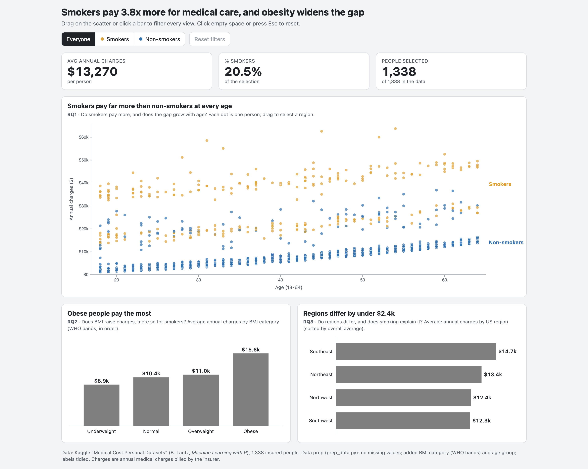
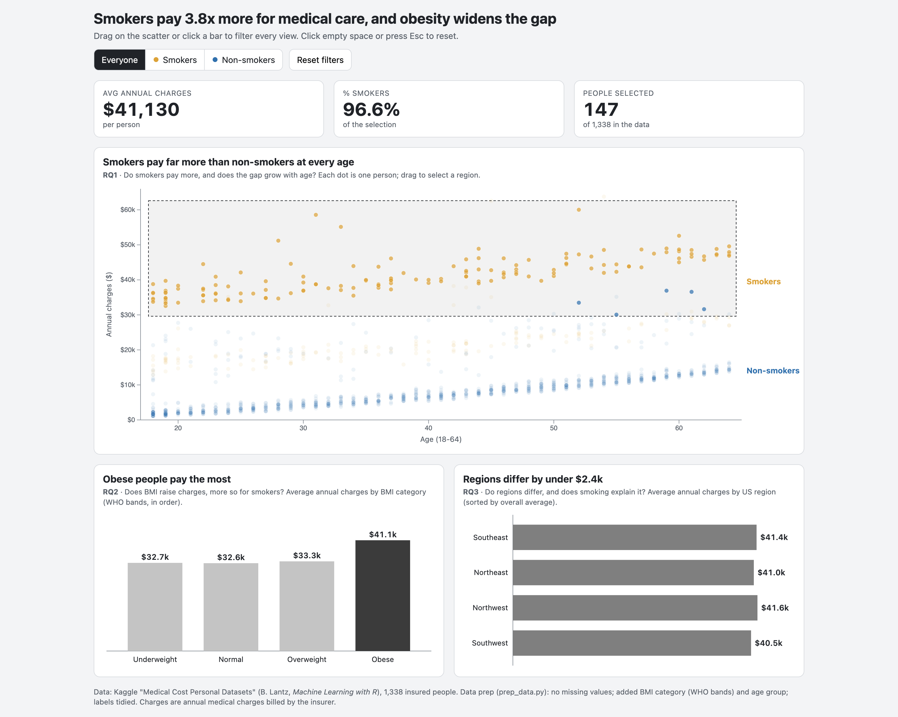

# What drives medical insurance charges?

An interactive dashboard built with D3.js v7: three coordinated views (age vs charges scatter, BMI-category bars, region bars) plus KPI tiles, with linked brushing and a smoker toggle.

Drag on the scatter or click a bar to filter every view. Click empty space, press Esc, or use "Reset filters" to clear.

## Run locally
Open `index.html` in a browser, or serve the folder: `python3 -m http.server 8000`.

## Files
- `index.html`: the dashboard.
- `CHANNELS.md`: which visual channel encodes each variable, and what changed from the proposal.
- `data.js`: cleaned data (generated by `prep_data.py`).
- `vendor/d3.min.js`: D3 v7.8.5 (ISC licence).
- `prep_data.py`: validates the raw Kaggle CSV, derives `bmi_category` and `age_group`, writes the cleaned CSV and `data.js`. It expects the raw file at `data/insurance.csv`, which is not included here.

## Data and credits
Kaggle "Medical Cost Personal Datasets" (mirichoi0218/insurance, from B. Lantz, *Machine Learning with R*), 1,338 rows. Charting library: D3.js (d3js.org).

Parts of this project were drafted with an AI coding assistant.
